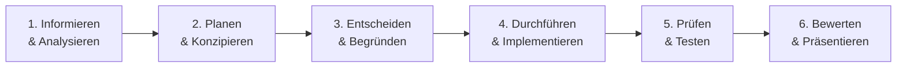

# 01. Projektübersicht & Lernfeld 7

> **Lernfeld 7:** Cyber-physische Systeme ergänzen  
> **Berufsfeld:** Fachinformatiker/in für Systemintegration (FiSi)  
> **Lernsituation:** Bonbon-Dosen-Fertigungsanlage CPR-01 (`#projekt-candy-ar`)  
> **Auftraggeber:** Thomas (Abteilungsleiter Fertigung & IT)

---

## 🎯 Ausgangssituation & Problemstellung

Im Rahmen der Industrie-4.0-Modernisierung einer mittelständischen Süßwaren-Manufaktur betreibt das Unternehmen die modulare Produktionslinie **CPR-01** zur automatisierten Befüllung und Verpackung von Bonbon-Dosen.

### Der bisherige Ist-Zustand:
1. **Sensordaten-Silos in der SPS:** Jede Station verfügt über moderne Sensorik (Wägezellen, Unterdrucksensorik, Lichttaster, Taktgeber), deren Werte jedoch primär in den lokalen Siemens/Codesys-Steuerungen verbleiben.
2. **Erschwerte Vor-Ort-Diagnose:** Tritt ein Fehler auf (z. B. Vakuumverlust beim Dosengreifen oder Füllgewichtsabweichung), müssen Werker und Instandhalter zu einem weit entfernten festen HMI-Terminal laufen oder ein PG (Programmiergerät) anschließen.
3. **Mangelnde Transparenz für die Betriebsleitung:** Weder für das Hallenmanagement noch für mobile Schichtleiter existierte ein leichtgewichtiger, plattformunabhängiger Live-Überblick über Taktraten, Ausschuss und OEE.

### Die Zielsetzung (Soll-Konzept):
* **Mobile Vor-Ort-Assistenz (WebAR):** Werker richten ein Smartphone oder Tablet auf einen optischen Marker (Hiro) an der jeweiligen Station und sehen sofort aktuelle Messwerte, Trends und Störmeldungen im direkten Sichtfeld eingeblendet.
* **SCADA-Leitstand ohne Hürden:** Ein moderner Leitstand im **HeroUI & SevDesk Stil** bündelt alle 4 Stationen in einer interaktiven Gesamtsicht – optimiert für Desktop-Monitore und Hallen-Großbildschirme, ohne dass eine AR-Kamera benötigt wird.
* **Vollständige IT/OT-Kopplung:** Standardisierte Protokolle (**OPC UA**, **MQTT**, **WebSockets**) verbinden speicherprogrammierbare Steuerungen mit modernen Webclients.

---

## 🔄 Phasen der vollständigen Handlung (FiSi)

### 1. Informieren & Analysieren
* Analyse der 4 Fertigungsstationen der Bonbon-Linie:
  * **Modul 1 (ST-010):** Dosen-Zuführung (Magazin-Füllstand, Vakuum-Unterdruck, Stückzähler).
  * **Modul 2 (ST-020):** Dosierung & Befüllung (Füllgewicht in Gramm, Pneumatikdruck, Taktrate).
  * **Modul 3 (ST-030):** Verschluss & Bördelung (Anpressdruck, Drehmoment, optische Nahtprüfung).
  * **Modul 4 (ST-040):** Qualitätskontrolle & Kontrollwaage (Kontrollgewicht, Ausschussquote, OEE).
* Aufnahme des OT-Netzwerks (IP-Bereich `192.168.10.0/24`, SPS-IPs `.11` bis `.14`).

### 2. Planen & Konzipieren
* Konzeption eines 3-Tier-Architekturmodells:
  * **OT-Tier:** SPSen mit OPC UA Server (Namespace `ns=2`).
  * **Middleware-Tier:** Node-RED Edge Gateway & Eclipse Mosquitto MQTT Broker.
  * **Applikations-Tier:** Node.js Express Backend mit In-Memory Zeitreihen-Store und WebAR/SCADA Clients.
* Festlegung der Nicht-Funktionalen Anforderungen:
  * Keine proprietäre App-Store-Installation (reine Standard-Webtechnologie HTML5/WebXR/WebAR).
  * Strikte 5-Minuten-Historie mit statistischer Vorberechnung (TTL 300s).
  * Betriebsfähigkeit sowohl im Docker-Verbund als auch rein statisch (GitHub Pages).

### 3. Entscheiden & Begründen
* **Warum WebAR (A-Frame + AR.js) statt nativer iOS/Android-App?**
  * Sofort einsatzbereit über jeden Web-Browser ohne Sideloading oder App-Store-Genehmigung.
  * Plattformübergreifend kompatibel mit industriellen Tablets, Smartphones und Laptops.
* **Warum Node-RED + WSS / MQTT?**
  * Node-RED bietet native OPC UA Nodes zur SPS-Abfrage.
  * Sichere WebSockets (`wss://`) erlauben Echtzeit-Streaming direkt in moderne Browser auch über HTTPS/GitHub Pages.

### 4. Durchführen & Implementieren
* Implementierung des modularisierten Frontends ([`js/app.js`](file:///root/bbk_cpr/js/app.js), [`js/ar-controller.js`](file:///root/bbk_cpr/js/ar-controller.js), [`js/ui-controller.js`](file:///root/bbk_cpr/js/ui-controller.js)).
* Aufbau des SCADA-Leitstands ([`overview.html`](file:///root/bbk_cpr/overview.html), [`js/overview.js`](file:///root/bbk_cpr/js/overview.js)).
* Realisierung des Backends mit [`KeyValueStore`](file:///root/bbk_cpr/backend/keyvalue-store.js), MQTT-Client, WebSocket-Server und RBAC-Sicherheitslayer.

### 5. Prüfen & Testen
* Automatisierte Unittests und Systemtests (53 Tests in Python `unittest`).
* End-to-End-Simulation von Lastzuständen und Störfällen.
* Überprüfung des automatischen Client-Routings (Mobilgerät $\rightarrow$ AR, Desktop $\rightarrow$ Leitstand).

### 6. Bewerten & Präsentieren
* Pitch für die Abteilungsleitung mit Live-Demonstration von Störungssimulation und Quittierung.
* Übergabe der Betriebsdokumentation im GitHub Wiki.
