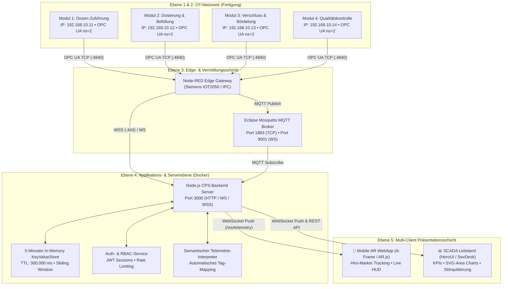

# 02. Systemarchitektur & Datenfluss

> **Architektur-Typ:** 4-Ebenen-Industrie-4.0-Architektur (Purdue-Modell / RAMI 4.0 konform)  
> **Komponenten:** Feldebene (SPS), Edge-Gateway (Node-RED), Application-Server (Docker) & Multi-Device Web-Clients.

---

## 🏛️ Schichtenmodell & Topologie

---

## 🔁 Die drei Betriebs- & Datenflussmodi

Die Plattform ist so ausgelegt, dass sie sich automatisch oder per Konfiguration an drei verschiedene Einsatzszenarien anpasst:

### Modus A: Live Node-RED Streaming (WSS)
1. Die SPSen stellen Prozessvariablen über den integrierten OPC UA Server bereit (`ns=2;s=ModulX.Tag`).
2. **Node-RED** fragt diese zyklisch ab (z. B. alle 500 ms) und transformiert sie in JSON-Objekte.
3. Über den gesicherten WebSocket-Endpunkt `wss://nodered.bbk.robin-w.de/ws/opcua` streamt Node-RED die Pakete direkt an das Backend oder an Web-Clients.
4. Der semantische Interpreter liest die Datenpunkte aus und aktualisiert den KeyValue-Store.

### Modus B: Lokaler Industrie-Docker-Betrieb (MQTT + Backend)
1. Sensordaten werden über das Topic-Schema `cps-i40/<StationID>/telemetry` an den Mosquitto MQTT Broker gesendet.
2. Das Backend abonniert alle Stations-Topics via Wildcard `cps-i40/+/telemetry`.
3. Der In-Memory Store bereinigt rollierend Daten, die älter als 5 Minuten sind, und sendet per WebSocket-Broadcast Aktualisierungen an alle verbundenen Webbrowser (`/ws/telemetry`).

### Modus C: Autarker Betrieb auf GitHub Pages (Serverless / Static Hosting)
1. Beim Aufruf über `https://alexmuellerit3.github.io/industrie-4.0-ar-mockup/` erkennt der Client den statischen Host.
2. Der Browser versucht zuerst, direkt eine sichere Verbindung zu `wss://nodered.bbk.robin-w.de/ws/opcua` aufzubauen.
3. Sollte die externe Quelle nicht erreichbar sein (z. B. Schulnetz-Firewall oder Offline-Betrieb), schaltet der Client nahtlos auf die integrierte **autarke SPS-Simulation**:
   * Eigener 5-Minuten Zeitreihen-Generator im Browser.
   * Lokales Login und Benutzerverwaltung im `localStorage`.
   * Volle visuelle Funktionalität ohne Server-Abhängigkeit.

---

## 🌐 Netzwerk- & Portübersicht

| Port | Protokoll | Dienst / Container | Verwendungszweck |
| :--- | :--- | :--- | :--- |
| **80 / 3000** | HTTP / WS | `backend` (Express) | WebApp Bereitstellung, REST API & WebSocket Telemetrie |
| **443** | HTTPS / WSS | `backend` (optional) | Gesicherte TLS-Kopplung bei direktem SSL-Zertifikat |
| **1883** | MQTT TCP | `mosquitto` | Industrielle Broker-Kommunikation für SPS / Gateways |
| **9001** | MQTT WS | `mosquitto` | MQTT über WebSockets für direkte Browser-Anbindung |
| **4840** | OPC UA TCP | Virtuelle / Physische SPS | Nativer Maschinen-Adressraum (ns=2) |
