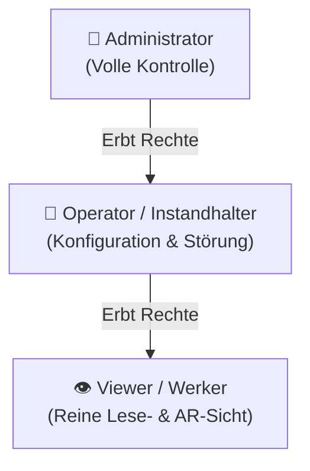

# 07. Sicherheitskonzept & RBAC

> **Sicherheits-Schichten:** Rollenbasierte Rechteverwaltung (RBAC), dynamische Gruppen, JWT-Sessions, Brute-Force-Schutz & Security Headers.  
> **Komponente:** [`backend/auth-service.js`](file:///root/bbk_cpr/backend/auth-service.js) & [`js/services/auth-service.js`](file:///root/bbk_cpr/js/services/auth-service.js)

---

## 🛡️ Rollenbasierte Zugriffskontrolle (RBAC)

Das System unterscheidet drei strikte Rollenebenen:



| Recht / Aktion | Viewer (`viewer`) | Operator (`operator`) | Admin (`admin`) |
| :--- | :---: | :---: | :---: |
| AR-Telemetrie & Dashboard ansehen | ✅ | ✅ | ✅ |
| Stations-Historie & KPIs abrufen | ✅ | ✅ | ✅ |
| Störungen simulieren & quittieren | ❌ | ✅ | ✅ |
| Toleranzwerte & IPs konfigurieren | ❌ | ✅ | ✅ |
| MQTT & WebSocket-Endpunkte ändern | ❌ | ❌ | ✅ |
| Gruppen & Benutzer verwalten | ❌ | ❌ | ✅ |

### Standard-Benutzerkonten (Out-of-the-Box):
* **Admin:** `admin` / `admin123`
* **Operator:** `operator` / `operator123`
* **Viewer:** `viewer` / `viewer123`

---

## 👥 Dynamische Gruppenverwaltung

Administratoren können im laufenden Betrieb neue Benutzergruppen mit maßgeschneiderten Berechtigungen anlegen:

* **Endpunkte:**
  * `GET /api/auth/groups`: Liste aller Gruppen und deren Permissions.
  * `POST /api/auth/groups`: Neue Gruppe erstellen (z. B. `"Schichtleiter"` mit Rechten `["telemetry:read", "config:write", "fault:simulate"]`).
  * `POST /api/auth/users`: Benutzer anlegen und einer Gruppe zuweisen.

---

## 🔒 Session-Management & Brute-Force-Schutz

### 1. Token-basierte Authentifizierung (JWT / Session-Tokens)
* Bei erfolgreichem Login über `POST /api/auth/login` erhält der Client ein sicheres Bearer-Token.
* Das Token wird bei allen schreibenden Anfragen im HTTP-Header mitgesendet:
  ```http
  Authorization: Bearer <token>
  ```

### 2. Brute-Force Rate Limiting
* Zum Schutz gegen Passwort-Attacken registriert der Auth-Service fehlgeschlagene Anmeldeversuche pro IP-Adresse.
* Nach **5 aufeinanderfolgenden Fehlversuchen** wird die anfragende IP-Adresse für **15 Minuten temporär gesperrt** (`HTTP 429 Too Many Requests`).

### 3. Autarker Client-Fallback (GitHub Pages / Offline)
* Auf statischen Hosts ohne Node.js-Backend validiert [`js/services/auth-service.js`](file:///root/bbk_cpr/js/services/auth-service.js) Anmeldungen sicher lokal gegen gespeicherte Credentials im `localStorage`.
* Sämtliche Rollen- und Gruppenfunktionen bleiben auch offline uneingeschränkt testbar!

---

## 🌐 HTTP Security Headers

Alle Antworten des Express-Backends werden durch restriktive Sicherheits-Header geschützt ([`backend/server.js`](file:///root/bbk_cpr/backend/server.js)):

* `X-Content-Type-Options: nosniff` (Verhindert MIME-Typ-Sniffing).
* `X-Frame-Options: SAMEORIGIN` (Clickjacking-Schutz).
* `X-XSS-Protection: 1; mode=block` (Browser-seitiger Cross-Site-Scripting-Filter).
* `Referrer-Policy: strict-origin-when-cross-origin`.
