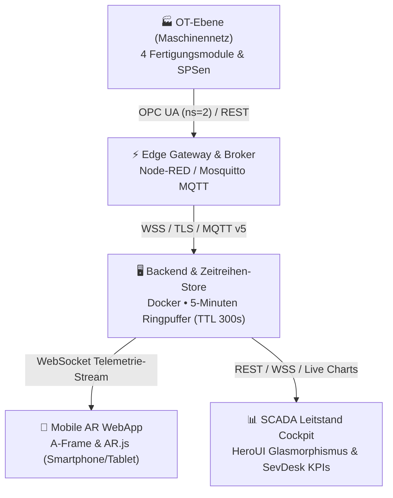

# Willkommen im CPS-i40 Candy-AR Wiki

> **Industrie 4.0 Telemetrie- & Augmented-Reality-Plattform für cyber-physische Produktionsanlagen**  
> *Lernfeld 7 (FiSi): Cyber-physische Systeme ergänzen • Produktionslinie CPR-01 (Bonbon-Fertigung)*

---

## 📌 Schnellübersicht

Das Projekt **CPS-i40 Candy-AR** demonstriert die nahtlose IT/OT-Integration einer realen modularen Fertigungsanlage (CPR-01 Bonbon-Dosen-Fertigung) mit modernsten Webtechnologien. Werker und Instandhalter vor Ort können Maschinendaten via **WebAR (Augmented Reality)** über optische Hiro-Marker direkt an der jeweiligen Station visualisieren, während Leitstandspersonal im **SCADA-Cockpit (HeroUI & SevDesk Stil)** die Gesamtanlage in Echtzeit überwacht.

---

## 📚 Inhaltsverzeichnis der Dokumentation

| Kapitel | Thema | Kurzbeschreibung |
| :--- | :--- | :--- |
| **[01. Projektübersicht & LF7](01-Projektuebersicht-und-Lernfeld-7)** | Didaktischer Rahmen | Lernfeld 7, Bonbon-Linie CPR-01, 6 Phasen der vollständigen Handlung |
| **[02. Systemarchitektur & Datenfluss](02-Systemarchitektur-und-Datenfluss)** | Architektur | Schichtenmodell (OT, Edge, Backend, Frontend), Protokolle & Topologie |
| **[03. AR-WebApp & Computer Vision](03-AR-WebApp-und-Computer-Vision)** | Augmented Reality | A-Frame, AR.js, Hiro-Marker, Kamera-Tracking, iOS/Android HMI HUD |
| **[04. SCADA-Leitstand & Design](04-SCADA-Leitstand-und-Designsystem)** | Dashboard UI/UX | HeroUI Glasmorphismus, SevDesk KPI-Karten, dynamische SVG-Area-Charts |
| **[05. Schnittstellen & Protokolle](05-Schnittstellen-und-Protokolle)** | Konnektivität | OPC UA (ns=2), Node-RED Live-WSS, MQTT v5 Broker, REST-Endpoints |
| **[06. Zeitreihen-Store & Aggregation](06-Zeitreihen-Store-und-Aggregationen)** | In-Memory Engine | 5-Minuten Gleitfenster (TTL 300s), Pruning, Min/Max/Avg, Quartils-Trends |
| **[07. Sicherheitskonzept & RBAC](07-Sicherheitskonzept-und-RBAC)** | Security & Auth | Rollenbasierte Rechte (Admin, Operator, Viewer), dynamische Gruppen, JWT |
| **[08. Semantische Dateninterpretation](08-Semantische-Dateninterpretation)** | Intelligente Daten | Automatische Endpunkt-Erkennung, Toleranzprüfung, deutsche Klartext-Synthese |
| **[09. Installation & Deployment](09-Installation-Docker-und-Deployment)** | DevOps | Docker, Docker-Compose, Port-Binding (`PORT`), GitHub Pages Hosting |
| **[10. Test-Suite & QS](10-Test-Suite-und-Qualitaetssicherung)** | Qualitätssicherung | 53 automatisierte Unittests, Integrationstests, Browser-Testsuite |
| **[11. Bedienungsanleitung & FAQ](11-Bedienungsanleitung-und-FAQ)** | Praxis-Leitfaden | Schnellstart für Werker & Ingenieure, Störungssimulation, Troubleshooting |

---

## 🚀 Live-Zugriff & Einstiegspunkte

* **SCADA-Leitstand (Desktop-Empfehlung):** [`overview.html`](overview.html)
* **Mobile AR-Kameraansicht (Smartphone/Tablet):** [`index.html?view=ar`](index.html?view=ar)
* **GitHub Pages Live Deployment:** `https://alexmuellerit3.github.io/industrie-4.0-ar-mockup/`
* **Node-RED OPC UA Live-Quelle:** `wss://nodered.bbk.robin-w.de/ws/opcua`

---

## 🛠️ Technische Kernparameter

* **Frontend:** Vanilla ES6 Module, A-Frame 1.4.0, AR.js 3.4.5, HeroUI Farb-Tokens, SevDesk Grid.
* **Backend:** Node.js (Express), `ws` (RFC 6455), `mqtt` v5 Client, HTTP/HTTPS & WSS Dual-Mode.
* **Persistenz:** In-Memory Key-Value Ringpuffer (TTL = 300.000 ms), `localStorage` Standalone-Cache.
* **Container:** Alpine Linux Node 20 / Mosquitto MQTT v2.0, Multi-Arch (x86_64, arm64).
